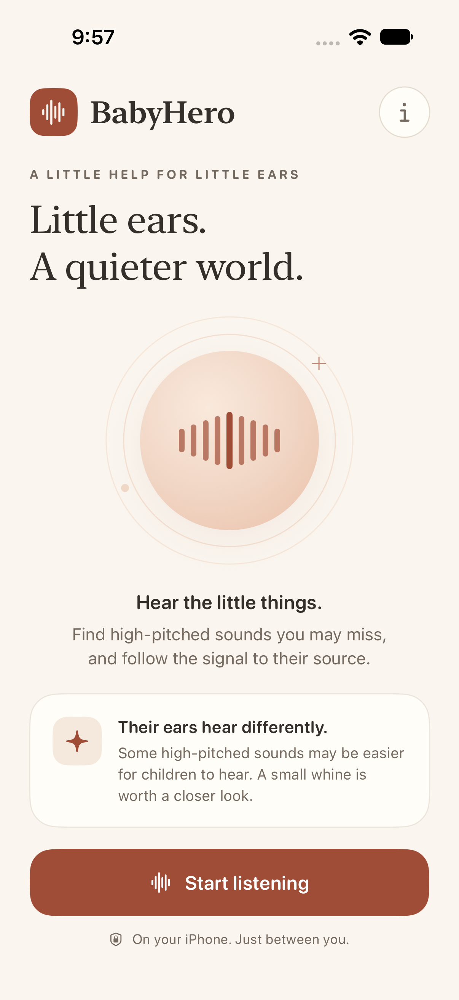
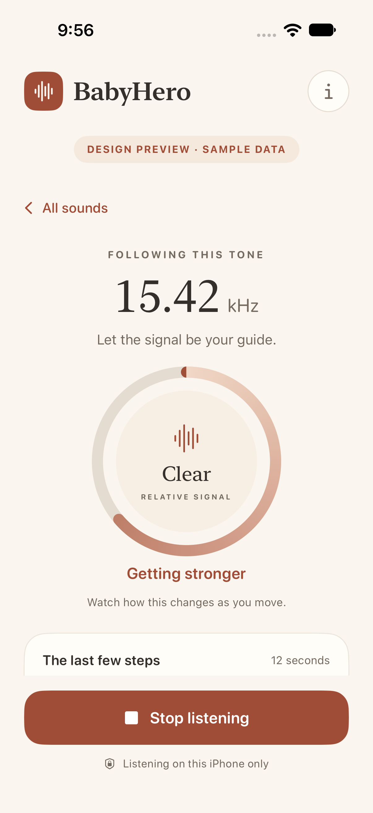

# BabyHero

A small, private iPhone app for finding persistent high-pitched tones and following their signal around a room. Open source under [ProfLLM](https://github.com/ProfLLM), licensed under [MIT](LICENSE). Native SwiftUI, iOS 17+, no external dependencies.

**Your data stays on your phone. No ads. No accounts. No account or usage tracking.** All audio analysis runs on the iPhone. BabyHero never sends microphone audio, sound measurements, identifiers, or usage data off the device. The app works offline.

 

## Run on your iPhone

1. Open **BabyHero.xcodeproj** in Xcode 16 or later.
2. Select the **BabyHero** scheme. Under **Signing & Capabilities**, choose your development team. Change the bundle identifier if your team needs a unique one.
3. Connect your iPhone, select it as the destination, and press **Run**. Follow Xcode’s prompts for Developer Mode and device trust if needed.
4. Tap **Start listening**, then allow microphone access. No permission is requested at launch.

The app requires no server, API key, account, or network connection. Signing is needed to install on a physical iPhone; the source includes no signing credentials.

## Use it

- Keep the microphone uncovered. Let the app listen for a few seconds.
- Tap a detected tone to open the finder. It stays on that tone even when another one gets louder.
- Walk slowly with the phone facing the same way. Pause and watch **Getting stronger**, **Getting weaker**, or **About the same**.
- Compare nearby electronics one at a time. **Signal lost** means the selected tone is no longer distinct, not that a room has been certified quiet.
- **Stop listening** ends capture. Leaving the app or changing the audio connection pauses it; tap **Start again** to resume with fresh comparisons.

The finder shows relative digital signal strength. It does not measure distance, direction, calibrated dB SPL, or risk to hearing. High-frequency microphone response varies by iPhone, case, grip, and input configuration. A detected tone cannot establish whether a baby hears or dislikes it, and an empty result cannot establish absence. This version focuses on persistent tones, not all environmental noise or short chirps.

## Privacy

Privacy is a foundation of this project. Audio is processed in bounded, transient memory and never saved or uploaded. There is no login, advertising, account tracking, usage tracking, analytics, history, or third-party SDK. Only the built-in microphone is used. No background audio capability is enabled. Links in the information sheet open only when tapped and contain no audio or measurement data.

Read the full [privacy promise](PRIVACY.md). Contributions must preserve it.

## Development

- `BabyHero/` contains the SwiftUI interface, permission/lifecycle model, microphone capture, assets, and privacy manifest.
- `Sources/BabyHeroCore/` is a local Swift package containing the streaming FFT detector and signal tracker. It runs on macOS for tests and iOS in the app.
- `Tests/` contains synthetic signal tests. `BabyHeroUITests/` covers navigation, permissions, large text, and foreground/background behavior.

Audio session setup and teardown run on a dedicated actor, with serial background signal analysis and main-actor presentation. Session operation numbers and request tokens reject stale starts, stops, selections, and readings after cancellation or restart.

Run the signal tests without a simulator:

```sh
swift test
```

GitHub Actions runs the signal tests and an unsigned iPhone Release build on pushes and pull requests. Tests use synthetic signals; customer audio is never involved.

Run the simulator UI tests using **Product → Test** in the BabyHero scheme, or:

```sh
xcodebuild -project BabyHero.xcodeproj -scheme BabyHero \
  -destination 'platform=iOS Simulator,name=iPhone 18 Pro' test
```

Use an installed simulator name on your Mac. The source targets iOS 17; this workspace was built with Xcode 27.1.

### Clearly labeled design fixtures

SwiftUI previews cover the welcome, listening, finder, and quiet states. For simulator screenshots, add these launch arguments in **Edit Scheme → Run → Arguments**:

```text
--preview-state finder
```

Available values: `idle`, `listening`, `finder`, `lost`, `quiet`, `paused`, `denied`. Fixtures display **DESIGN PREVIEW · SAMPLE DATA** and do not activate the microphone. Remove the arguments to use live capture. Production launches do not enter a fixture automatically.

### Signal defaults

The detector uses 8,192-sample Hann windows with 50% overlap and averages spectral power over roughly 0.3 seconds. Candidates require 8 dB of local prominence in the averaged spectrum, a −85 dBFS floor, and current-frame evidence at least 3 dB above the averaged local background. A tone needs 0.75 seconds of persistence; clear tones are confirmed in about one second of audio at typical input sample rates. Short-term averaging helps weak steady tones survive noise fluctuations, while current-frame evidence prevents an old average alone from retaining a stopped tone. The search band is 8 kHz through the lesser of 20 kHz and 45% of the actual sample rate. A 48 kHz request is a preference, not a measurement of the microphone’s response.

The finder measures a narrow band around the selected tone (100 Hz matching tolerance), smooths its digital level, and compares consecutive one-second windows with a 3 dB deadband. The circular gauge uses a fixed −90 to −10 dBFS display scale; this is not a sound-pressure calibration. History is limited to 12 seconds and discarded when stopping. Dropped buffers reset persistence and comparisons rather than joining discontinuous audio.

See [Validation](Documentation/Validation.md) for automated results and the physical-device protocol still needed before claiming hardware detection performance. The app never plays test tones.

The app icon is included. Regenerate it, if needed, with:

```sh
swift Tools/GenerateIcon.swift BabyHero/Assets.xcassets/AppIcon.appiconset/AppIcon.png
```

## Contributing

See [CONTRIBUTING.md](CONTRIBUTING.md) for the project foundations and checks. Report issues and propose changes in [ProfLLM/BabyHero](https://github.com/ProfLLM/BabyHero). Please use synthetic signals rather than sharing household recordings.

## License

[MIT](LICENSE). Copyright © 2026 ProfLLM.
